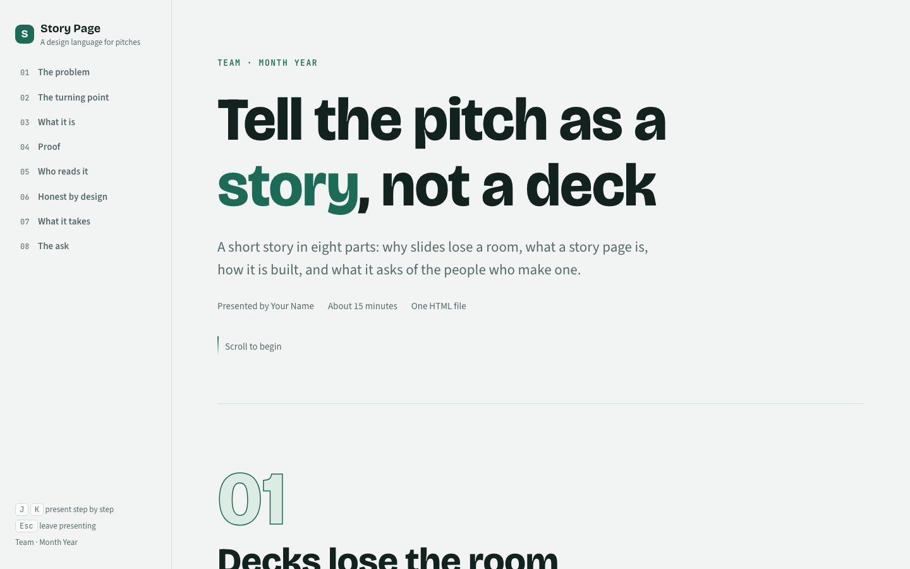
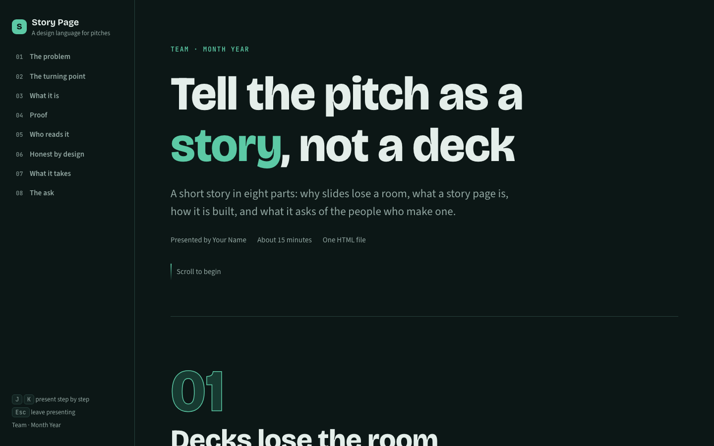
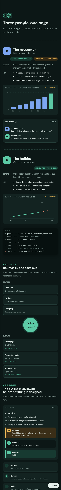
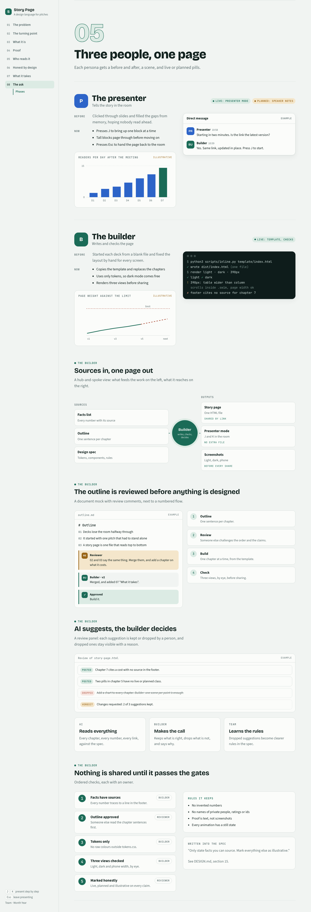

# Story Page

A design language for pitches that read like a story. One scrolling column, numbered chapters, a sticky chapter rail, proof rebuilt as live mocks (chats, terminals, documents, charts), and a presenter mode that shows one block at a time with **J** and **K**.

It is plain HTML, CSS and about 120 lines of JavaScript. No framework, no build step, and it ships as one file.



| Dark | Phone |
|---|---|
|  |  |

## What's here

| Path | What it is |
|---|---|
| [`DESIGN.md`](DESIGN.md) | The full specification: principles, narrative arc, layout and rhythm, type scale, colour tokens, motion table, every component, presenter mode, responsive rules, accessibility, content rules and the pre-share checklist |
| [`src/tokens.css`](src/tokens.css) | Colours (light and dark), fonts, shadow and easing |
| [`src/story.css`](src/story.css) | Every component |
| [`src/story.js`](src/story.js) | Reveal on scroll, count-up numbers, scroll spy, progress bar, mobile drawer and presenter mode |
| [`template/index.html`](template/index.html) | A starter story that uses every component once and explains the system as it goes |
| [`scripts/inline.py`](scripts/inline.py) | Inlines the CSS and JS into one self-contained HTML file |
| [`docs/screenshots/`](docs/screenshots) | Light, dark and phone renders of the template |

## Quick start

```bash
cp template/index.html my-story.html     # keep the shell, replace the chapters
open my-story.html                       # works straight from disk
python3 scripts/inline.py my-story.html  # → dist/my-story.html, one file to share
```

Then follow the checklist in [DESIGN.md §17](DESIGN.md#17-building-checking-and-shipping): light, dark and phone width, no sideways scroll, J/K through every chapter, every claim marked live or planned, and every made-up number marked illustrative.

## The idea in six lines

1. **Story, not slides.** One argument, in order, from problem to ask. Every heading is a sentence.
2. **Proof next to the claim.** A scene puts the claim on the left and a readable mock on the right.
3. **Visible at rest.** Animation only replays an entrance; the page reads fully without JavaScript.
4. **Motion explains.** Messages arrive at reading pace, terminals type, bars grow, and flow lines move the way data moves.
5. **Honest by construction.** Live versus planned, solid versus dashed, and an "Illustrative" label on anything made up.
6. **Works alone, everywhere.** Without a presenter, on a phone, in light and dark, with reduced motion.


